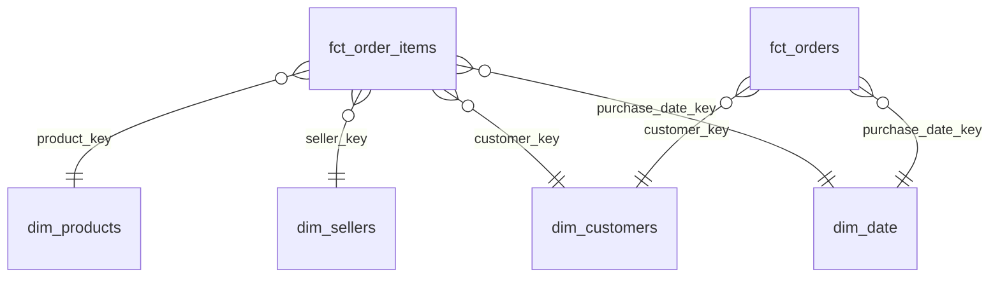

# Modelo estrella de un e-commerce real (dbt + DuckDB)

**Sitio:** https://nbbz95.github.io/modelo-estrella-ecommerce/ · **Documentación y linaje de dbt:** https://nbbz95.github.io/modelo-estrella-ecommerce/docs/

Modelo dimensional sobre el dataset público de **Olist** (100 mil órdenes de un marketplace brasileño, 2016-2018): de 8 CSV crudos a dos tablas de hechos y cuatro dimensiones, listas para conectar a Power BI, Looker, Tableau o SQL directo.

## El modelo



| Tabla | Grano (una fila =) | Para qué |
|---|---|---|
| `fct_order_items` | una línea de orden | ventas por producto, categoría, vendedor, región |
| `fct_orders` | una orden | ticket promedio, medio de pago, puntualidad, reseñas |
| `dim_customers` | un cliente real (`customer_unique_id`) | región, primera compra, recompra |
| `dim_products` | un producto | categoría en inglés, franja de tamaño |
| `dim_sellers` | un vendedor | estado y región |
| `dim_date` | un día | año, trimestre, mes, fin de semana |

## Decisiones de modelado

- **Dos hechos con distinto grano** en vez de una tabla gigante: el flete y la reseña son de la orden, el precio es de la línea. Mezclarlos duplica montos.
- **El cliente es `customer_unique_id`**, no `customer_id`: Olist genera un `customer_id` por orden, así que contar clientes con esa columna infla la base y esconde la recompra (que es del 3,1%).
- **Reseñas deduplicadas** en staging: algunas órdenes tienen más de una; se queda la última respondida.
- **Región derivada del estado** con una macro reutilizable para clientes y vendedores.

## Calidad de datos

`dbt build` corre 49 nodos entre modelos y tests:

- `unique`, `not_null` y `accepted_values` en claves y estados.
- `relationships` de cada clave foránea de los hechos contra su dimensión.
- Test genérico propio de unicidad de combinación de columnas (sin depender de paquetes externos).
- Tests de negocio: la facturación de los dos hechos reconcilia al centavo, lo pagado coincide con productos + flete en más del 99% de las órdenes, y ninguna orden se entrega antes de comprarse.

## Cómo correrlo

```bash
pip install -r requirements.txt
./scripts/descargar_datos.sh          # baja los CSV del repo oficial de Olist
dbt build --profiles-dir .            # modelos + tests
dbt docs generate --static --profiles-dir .
python scripts/build_site.py          # arma site/ con el resumen y la documentación
```

GitHub Actions hace lo mismo en cada push y publica el sitio en la rama `gh-pages`.

**Datos:** [Olist, Brazilian E-Commerce Public Dataset](https://github.com/olist/work-at-olist-data), licencia CC BY-NC-SA 4.0.
